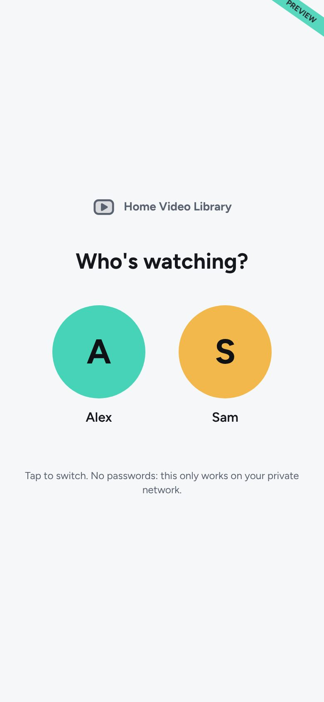
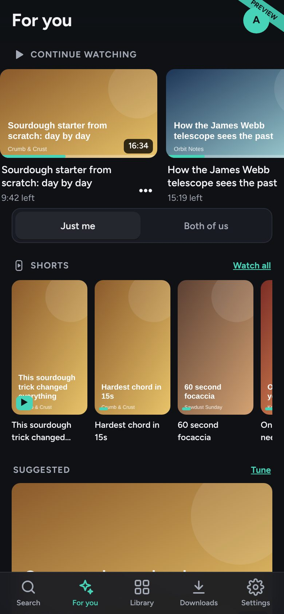
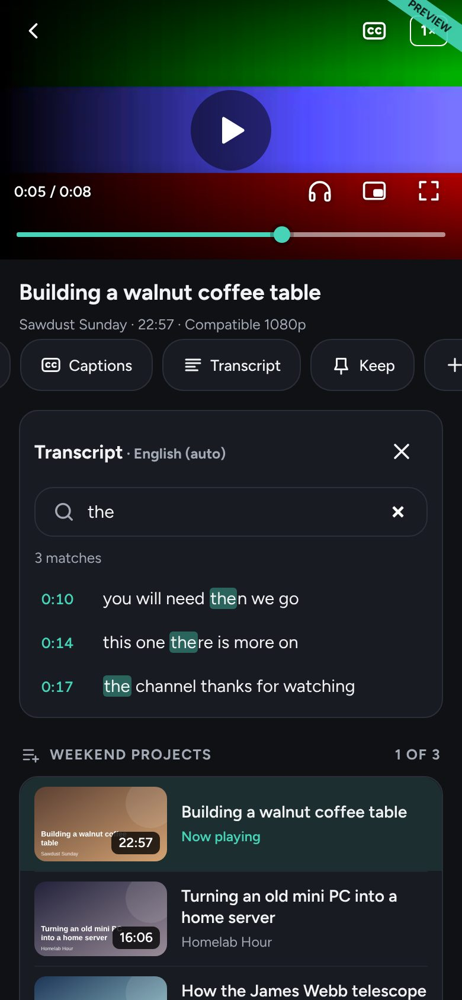
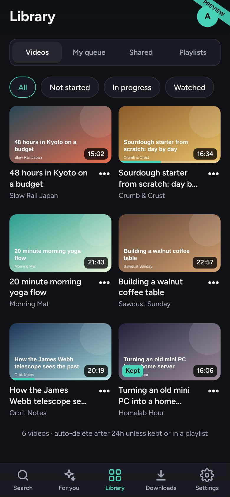

# Home Video Library

A private, self-hosted, YouTube-Premium-like video app for one household. It
runs on a small Ubuntu Server box at home and is used from iPhones (as a Home
Screen web app) over [Tailscale](https://tailscale.com). You search YouTube,
the server downloads the video with [yt-dlp](https://github.com/yt-dlp/yt-dlp),
and you watch it ad-free from your own library, even with no internet.

There are no accounts or passwords in the app. Your Tailscale network is the
only way in (see [Security](#security)).

| Profiles | For you | Player | Library |
|---|---|---|---|
|  |  |  |  |

## Features

- **Search and download**: YouTube search, pasted links, Shorts. Choose
  "Compatible 1080p" (H.264, plays in Safari) or best quality.
- **Two profiles** with their own queues, watch history, continue watching,
  themes, profile photos and recommendations, plus a shared queue and shared or
  personal playlists.
- **Private by default**: what you download only shows up for your profile.
  "Share with both of us" (when downloading, or later from the video or a
  playlist) puts it in front of both of you.
- **Player**: drag scrubbing with time preview, YouTube-style double-tap skip,
  playback speed, captions with a searchable transcript you can copy, audio-only mode,
  picture-in-picture and lock-screen controls.
- **Delete after watching**: downloads are removed once everyone they're for
  has watched them, or after 12/24/48 hours. Pin with "Keep" to stop that.
- **"For you" recommender** that runs locally and reloads itself overnight, or
  whenever you tap reload, with all-new suggestions. You can see why each video
  was suggested and edit or forget what it learned.
- **Shorts feed** that prefetches in the background.
- **Music page**: YouTube Music search, mp3/m4a downloads, a mini player, and
  saving songs to the iPhone.
- **iOS share-sheet shortcut** to send a video from the YouTube app straight
  to your queue.
- **Offline installer**: one zip with every Python wheel, so the server needs
  no internet during installation.

Try the UI without a server: open [`preview/index.html`](preview/index.html)
in a browser (it uses mock data). All screenshots are in [`docs/screenshots/`](docs/screenshots/).

## Requirements

| | |
|---|---|
| **Server** | Any x86_64 PC with Ubuntu Server 22.04, 24.04 or 26.04 LTS. 4 GB RAM and an SSD are enough. |
| **Python** | 3.10 to 3.14 (the version Ubuntu ships is fine) |
| **ffmpeg** | `sudo apt install ffmpeg` is recommended. A bundled `imageio-ffmpeg` binary is used as a fallback. |
| **yt-dlp** | Installed automatically into the app's venv (with the `deno` JS runtime it needs for YouTube). Update it with `sudo /opt/homelib/update.sh --yt-dlp-online`. |
| **Tailscale** | On the server and on every phone or computer that uses the app |
| **Clients** | iPhone/iPad Safari (primary target), or any modern browser on your tailnet |

## Setup

The full beginner-friendly walkthrough is in
[`docs/SETUP_CHECKLIST.md`](docs/SETUP_CHECKLIST.md), starting from a blank
USB stick. In short:

1. **Install Ubuntu Server** on the box ([`docs/UBUNTU_INSTALL.md`](docs/UBUNTU_INSTALL.md); Wi-Fi only: [`docs/WIFI.md`](docs/WIFI.md)).
2. **Download the offline package**, [`homelib-usb.zip`](https://github.com/Justin314159/Personal-video-server-public/releases/latest/download/homelib-usb.zip) (~100 MB),
   from the latest [Release](../../releases/latest). To build it yourself instead,
   on any Linux or macOS machine with internet access:
   ```bash
   bash scripts/build_usb.sh          # creates dist/homelib-usb.zip
   ```
   Releases are built by the "Build release" GitHub Actions workflow (`.github/workflows/release.yml`).
3. **Install on the server**:
   ```bash
   scp homelib-usb.zip YOUR_USERNAME@YOUR_SERVER_LAN_IP:~
   ssh YOUR_USERNAME@YOUR_SERVER_LAN_IP
   python3 -m zipfile -e homelib-usb.zip . && cd homelib-usb
   sudo bash install.sh
   ```
   This creates a `homelib` system user, puts the app in `/opt/homelib`, the
   config in `/etc/homelib/config.toml` and data in `/var/lib/homelib`, and
   starts the `homelib` systemd service on `127.0.0.1:8787`.
4. **Put it on your tailnet with HTTPS**:
   ```bash
   curl -fsSL https://tailscale.com/install.sh | sh
   sudo tailscale up
   sudo tailscale serve --bg 8787
   ```
   This prints `https://YOUR_SERVER_HOSTNAME.YOUR_TAILNET.ts.net`. **Never use
   `tailscale funnel`** for this app, because Funnel makes it public on the internet.
5. **On each iPhone**: install Tailscale, sign in with the same account, open
   the `https://….ts.net` address in Safari, then Share → **Add to Home Screen**.

Day-to-day operation (updates, backups, logs, troubleshooting) is in
[`docs/OPERATIONS.md`](docs/OPERATIONS.md).

## Configuration

Settings live in a TOML file, and a few can be overridden with environment variables.

- **Config file**: [`packaging/config.example.toml`](packaging/config.example.toml)
  documents every key. The installer copies it to `/etc/homelib/config.toml`
  (it is never overwritten on re-install). The path can be changed with `HOMELIB_CONFIG`.
- **Environment variables**: [`.env.example`](.env.example) lists them:
  `HOMELIB_BIND`, `HOMELIB_PORT`, `HOMELIB_DATA_DIR`, `HOMELIB_LIBRARY_DIR`,
  `HOMELIB_PROFILE_NAMES`, `HOMELIB_COOKIES_FILE`, `HOMELIB_MOCK`. They win
  over the file. The systemd service reads `/etc/homelib/homelib.env` if it
  exists, and `run.sh` reads `./.env`.

```bash
sudo install -m 600 .env.example /etc/homelib/homelib.env   # then edit it
sudo systemctl restart homelib
```

The settings you'll most likely change:

| Setting | Default | Notes |
|---|---|---|
| `[profiles] names` / `HOMELIB_PROFILE_NAMES` | `Profile 1`, `Profile 2` | Used when the database is first created. Rename later in Settings. |
| `[server] bind` / `HOMELIB_BIND` | `127.0.0.1` | Keep this and use `tailscale serve`. `0.0.0.0` is refused unless `allow_all_interfaces = true`. |
| `[library] dir` | `/var/lib/homelib/library` | Where the mp4s go. |
| `[cleanup] auto_delete_hours` | `24` | 12, 24 or 48 |
| `[tools] cookies_file` / `HOMELIB_COOKIES_FILE` | empty | Only if YouTube starts asking "confirm you're not a bot". See `docs/OPERATIONS.md`. |

The app needs no hostname, IP or tailnet name in its config. With the default
`bind = "127.0.0.1"`, `tailscale serve` handles the HTTPS address.

**Never commit** your real `config.toml`, `.env`/`homelib.env`, a `cookies.txt`,
the database or downloaded media. [`.gitignore`](.gitignore) already excludes them.

## Security

The app has **no login of its own**. Anyone who can reach it can use it, so
access control is entirely Tailscale's job:

- **Keep it private.** Leave `bind = "127.0.0.1"` and publish it only with
  `tailscale serve`. Never `tailscale funnel`, never port-forward it on your
  router, and never set `allow_all_interfaces = true` on a network you don't fully trust.
- **Turn on two-factor authentication** on the account you use to log in to
  Tailscale (Google, Microsoft, GitHub, Apple, or Tailscale's own MFA). That
  login is effectively the password to your server.
- **Use Tailscale ACLs** (access controls in the admin console) so that only
  your own users or devices can reach the server, and only on the app's port
  (e.g. `tcp:443` for `tailscale serve`, plus `tcp:22` for SSH from your laptop).
  Don't rely on the default allow-all policy if anyone else shares your tailnet.
- Review the devices on your tailnet now and then, and remove ones you no longer use.
- Keep Ubuntu updated (`sudo apt update && sudo apt upgrade`), and keep yt-dlp
  updated (`sudo /opt/homelib/update.sh --yt-dlp-online`).
- If you use a YouTube `cookies.txt`, treat it like a password: `chmod 600`,
  owned by the `homelib` user, and never committed or shared.

## Disclaimer

This project is for personal, private use. You are responsible for making sure
your use of it complies with YouTube's Terms of Service, the rights of content
owners, and the laws where you live. Only download content you have the right
to download. The authors don't endorse or take responsibility for misuse.
This software is provided "as is", without warranty of any kind (see [LICENSE](LICENSE)).

## Development

```bash
cd backend && python3 -m venv .venv && . .venv/bin/activate
pip install -r requirements-dev.txt
pytest                                                   # runs in mock mode, no internet
HOMELIB_MOCK=1 HOMELIB_DATA_DIR=/tmp/hl python -m homelib # http://127.0.0.1:8787
```

Regenerate the static preview with `python scripts/build_preview.py` (needs
ffmpeg). Regenerate the screenshots with Playwright:
`node scripts/screenshots.js file://$PWD/preview/index.html docs/screenshots`
and `node scripts/screenshots_player.js file://$PWD/preview/index.html docs/screenshots`.

```
backend/homelib/        FastAPI app, yt-dlp worker, cleaner, recommender, mock layer
backend/homelib/static/ frontend (plain HTML/CSS/ES modules, no build step)
backend/tests/          pytest (mock mode, no internet)
preview/                generated static preview (scripts/build_preview.py)
preview_src/mockapi.js  in-browser fake API used by the preview
packaging/              install/update/uninstall/backup/selfcheck/run scripts, config example
scripts/                build_preview.py, build_usb.sh, screenshot scripts
docs/                   setup, operations, architecture, design decisions
```

How it works and why: [`docs/ARCHITECTURE.md`](docs/ARCHITECTURE.md),
[`docs/DECISIONS.md`](docs/DECISIONS.md). iPhone specifics:
[`docs/IOS_PLAYBACK.md`](docs/IOS_PLAYBACK.md), [`docs/IOS_SHORTCUT.md`](docs/IOS_SHORTCUT.md).

## License

[MIT](LICENSE)
